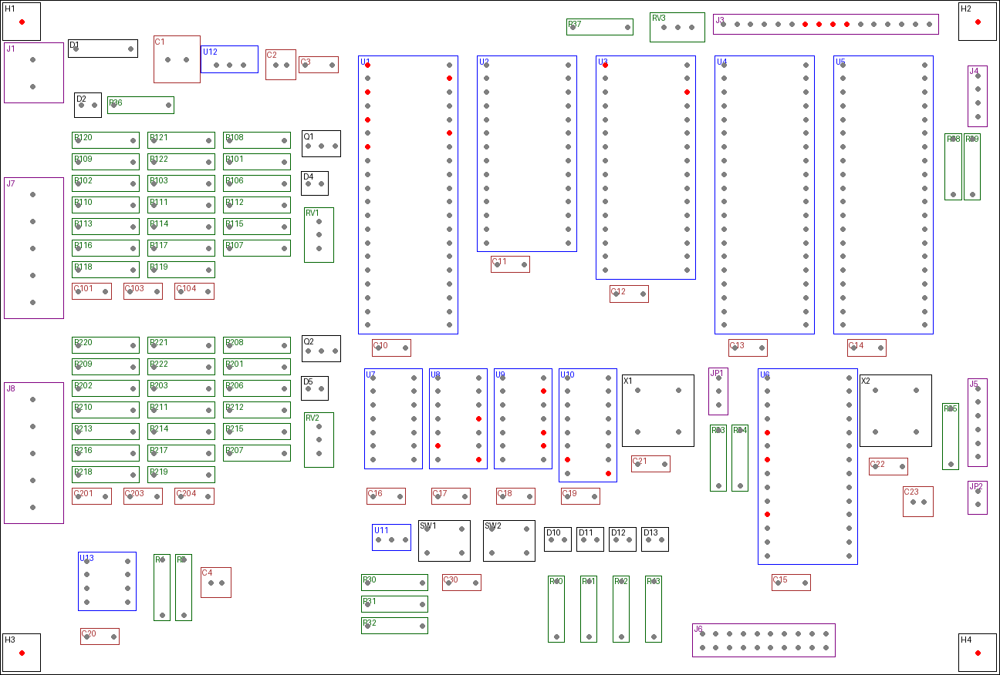

# C02COMM: a through-hole W65C02S board for the radio projects

This is a single board computer for the APRS TNC and the AMTOR station: a WDC W65C02S, RAM, flash, two radio ports, an LCD and keyboard connection, and USB serial to a PC. **Every part is through-hole** and every chip sits in a socket, so it can be built and repaired with a soldering iron. The PCB is a 2-layer **185 × 125 mm** board to order from JLCPCB, PCBWay or similar.

**Status: routed, DRC clean, Gerbers ready.** Placement, schematic, netlist and routing are done. KiCad's DRC shows 0 errors and 0 unconnected pads. `python mk_fab.py` writes `fab/c02comm_gerbers.zip` (not committed; regenerate it). Nothing has been built.



## What's on it

| Block | Parts | Notes |
|---|---|---|
| CPU | W65C02S, 3.6864 MHz oscillator | The same clock as the existing TNC and AMTOR code. The oscillator is socketed: change it to change the speed. |
| RAM | AS6C62256, 32 KB | `$0000-$7EFF` |
| Flash | SST39SF010A, 128 KB | The same chip as on the W65C134SXB. `$8000-$FFFF` shows one of four 32 KB banks. JP1 write-protects it. |
| VIA1 | W65C22N | The two radio ports |
| VIA2 | W65C22N | 20x4 LCD, PS/2 keyboard, flash bank select, 4 LEDs |
| ACIA | W65C51N, 1.8432 MHz oscillator | Serial to a plug-in USB module (FTDI or CH340, 5 V) |
| Radio ports ×2 | LM393, 2N7000, R-2R DAC | The same circuit as `../radio_interface.svg`, already proven with the TNC |
| Reset | DS1813 | Clean power-on reset, plus a RESET and an NMI button |
| Power | 1N5819, LM7805 | 9-15 V in on a screw terminal, so 13.8 V from the radio supply is fine |

## Memory map

| Address | What |
|---|---|
| `$0000-$7EFF` | RAM |
| `$7F00-$7F0F` | VIA1 (radios) |
| `$7F10-$7F1F` | VIA2 (LCD, keyboard, bank, LEDs) |
| `$7F20-$7F2F` | ACIA |
| `$7F30`, `$7F40`, `$7F50` | `/CS3`, `/CS4`, `/CS5` on the I/O header, 16 bytes each |
| `$7F60-$7FFF` | free |
| `$8000-$FFFF` | flash bank 0-3 (VIA2 PA6 = A15, PA7 = A16) |

- **Bank at reset:** the bank lines are pulled low, so bank 0 is selected and the reset vector comes from bank 0.
- **Writing the flash:** writes use the same command sequence as `../../tools/sxb134/flash134.asm` (`$D555` / `$AAAA`), running from RAM.
- **Decoding:** a 74HC00, a 74HC30 and a 74HC138. `check_board.py` simulates the decoding for all 65536 addresses.

## Port pins

**VIA1 (`$7F00`).** Radio 1 is wired exactly like the MyMENSCH's VIA_A port A, so the TNC code needs only new addresses:

| Pin | Radio 1 (port A) | Radio 2 (port B) |
|---|---|---|
| P0-P3 | DAC bits 0-3 | DAC bits 0-3 |
| P4 | PTT (and the red TX1 LED) | PTT (TX2 LED) |
| P5 | SQC from the radio | SQC |
| P6 | spare, on the I/O header | spare, on the I/O header |
| P7 | comparator (RX audio) | comparator |
| CA1 / CB1 | the same comparator, for edge interrupts | the same comparator |

**VIA2 (`$7F10`):**

| Pin | Use |
|---|---|
| PA0-PA3 | LCD D4-D7 |
| PA4 / PA5 | LCD RS / E (R/W is tied low) |
| PA6 / PA7 | flash A15 / A16 (bank) |
| PB0-PB3 | LED0-LED3 (lit when high) |
| PB4-PB7, CB1, CB2 | I/O header |
| CA1 / CA2 | PS/2 clock (interrupt on the falling edge) / data |

**Interrupts:** `/IRQ` is shared by VIA1, VIA2 and the ACIA, with a 3.3k pull-up. That's why both VIAs must be the **W65C22N** (open-drain IRQ), **not the W65C22S**, whose IRQ output is push-pull.

## Connectors

| Ref | Connector | Pins |
|---|---|---|
| J1 | 2-way screw terminal | 1 = +9-15 V, 2 = GND. A reversed supply is blocked by D1. |
| J7, J8 | 5-way screw terminal, one per radio | 1 ANI, 2 GND, 3 PTT, 4 ANO, 5 SQC |
| J3 | 1x16 header | HD44780 LCD in its own pin order (VSS VDD V0 RS RW E D0-D7 A K). RV3 sets the contrast. |
| J4 | 1x4 header | PS/2 socket breakout: +5V GND CLK DATA |
| J5 | 1x6 header | USB-serial module, FTDI order: GND CTS VCC TXD RXD RTS |
| J6 | 2x10 header | +5V, GND, the spare VIA lines, `/CS3-5`, `/IRQ`, `/RES`, PHI2, R/W |
| JP1 | 3-pin jumper | flash write: 1-2 = writable, 2-3 = protected |
| JP2 | 2-pin jumper | powers the board from the USB module. Fit it **only** when nothing is on J1. |

**Radio cable:** use a 6-pin mini-DIN male cable (a cut PS/2 extension cable works) wired to the terminal. The pin numbers are the TS-480 / TM-V71A data port's:

| Terminal | Data port pin | Signal |
|---|---|---|
| 1 ANI | 1 | audio into the radio |
| 2 GND | 2 | ground |
| 3 PTT | 3 | PTT (pulled to ground by the 2N7000) |
| 4 ANO | 5 | audio out of the radio |
| 5 SQC | 6 | squelch / busy |

Pin 4 isn't used. Check the cable's colours with an ohmmeter, because PS/2 cables differ.

## Building it

- **Sockets:** put every DIP chip in a socket. The chips are 0.6" wide for the CPU, RAM, flash, VIAs and ACIA, and 0.3" for the logic and the LM393. The oscillators fit 8-pin sockets (14-pin full-can parts also fit their 4 corner holes). A ZIF socket for the flash is handy if you reflash it out of circuit.
- **Do not fit R121 and R221.** They are the 20k SQC dividers for a 3.3 V board, marked DNP on the board.
- **LM7805 heat:** at 13.8 V in and about 200 mA with the LCD backlight on, the LM7805 dissipates around 2 W. Fit a clip-on TO-220 heatsink.
- **Setting the audio level:** set RV1 / RV2 (TX audio level) with the radio on a dummy load, as in `../../tnc/README.md`.
- **ACIA bug:** the W65C51N's "transmit register empty" bit is stuck on, a known silicon bug. Send with a delay of one character time (about 1.04 ms at 9600 baud) instead of polling it.

Parts are listed in `bom.csv`, written by `python mk_fab.py --bom`.

## Files

| File | What it is |
|---|---|
| `board.py` | **The design.** Every part, footprint, position and pin-to-net connection. Edit this, then regenerate everything else. |
| `check_board.py` | Plain Python. Checks the design (see below). |
| `mk_pcb.py` | Run with KiCad's Python. Builds `c02comm.kicad_pcb`: placement, nets, ground planes on both layers, design rules. It also writes `c02comm.dsn` for the autorouter, and imports `c02comm.ses` (the routed tracks) when it exists. |
| `mk_sch.py` | Writes `c02comm.kicad_sch` and the `c02` symbol library. Chips are drawn by their DIP pinout, with a net label on every pin. |
| `check_place.py` | KiCad Python. Checks that no courtyards overlap and that all parts are on the board, and draws `place.png`. |
| `mk_fab.py` | Routes (optionally), runs DRC, writes the Gerber zip in `fab/`, and writes `bom.csv`. |
| `c02comm.kicad_pro/.kicad_pcb/.kicad_sch` | The KiCad 10 project; open it in KiCad to look around. |

Regenerate after editing `board.py`:

```
python check_board.py
python mk_sch.py
"C:\Program Files\KiCad\10.0\bin\python.exe" mk_pcb.py
"C:\Program Files\KiCad\10.0\bin\python.exe" check_place.py png
```

## Checks

`check_board.py` passes all of these:
- **Nets and pins:** every net joins at least two pins, and every chip lists all its pins.
- **Chip pinouts:** power and ground are on each chip's datasheet pins, and every chip has a decoupling capacitor.
- **Buses:** the CPU's address and data lines reach the right pins of the RAM, flash, both VIAs and the ACIA.
- **Decoding:** the gate network, simulated from the netlist, matches the memory map for every address. Exactly one chip is selected at a time.
- **Strobes:** `/RD` happens only on reads and `/WR` only on writes, and both only while PHI2 is high.
- **Radio ports:** both are wired the same way, and the DAC bit order and the 2N7000 orientation are right.
- **Keyboard and interrupts:** the PS/2, LCD, interrupt and serial wiring are right.

In KiCad:
- **ERC:** 0 violations.
- **Schematic against board:** the schematic's netlist, exported by KiCad, has the same 129 nets, pin for pin, as `board.py` and the PCB.
- **DRC (unrouted):** no clearance or edge errors. All that's left is the 319 connections waiting for tracks, plus cosmetic silkscreen overlaps of reference text.

## Routing

The board has 319 connections, mostly the address and data buses. They are routed with **Freerouting 2.5.0**, installed from its official MSI at `C:\Users\kc4um\AppData\Local\freerouting\`. Its usage statistics are turned off in `%APPDATA%\freerouting\freerouting.json` (`allow_telemetry: false`, `disable_analytics: true`).

### Where it stands (2026-11-19)

**Run 1: every connection routed, but it failed KiCad's DRC.** Freerouting left GND for the copper planes to connect. On this board the bus tracks cut the planes into islands, so 13 GND pins were left isolated, among them pins on U1, U2, U8 and U9.

**Fix, in `mk_pcb.py`:**
- **GND as tracks:** GND is now routed as ordinary tracks, and the two ground planes are added only after the tracks are imported, as extra copper.
- **Rules:** the minimum track is 0.15 mm, where Freerouting narrows tracks into pads. Copper may come within 0.3 mm of the edge, which board houses allow.
- **Thermals:** `c02comm.kicad_dru` allows a thermal relief with a single spoke, since every GND pin also has its own track.

**Run 2: all 319 connections routed with 0 violations after 11 passes, but no result saved.** Claude Code stopped the run in Freerouting's final "optimizer" stage, because the PC was low on memory. `mk_fab.py` now runs Freerouting with `-mt 2` (2 threads) to use less memory.

**Run 3 (2026-11-19): all 319 connections routed, 0 unconnected pads.** The optimizer pass made the score worse and was rejected, so the router's result was kept. `drc.txt` lists 6 `starved_thermal` errors: GND pads on Q1, Q2, U5, J6 and R41 whose thermal spokes reach only an isolated island of the plane. Every one of these pads also has its own GND track, so they are connected. **Fixed:** KiCad ignored the one-spoke rule in `c02comm.kicad_dru` and used the board's default minimum of 2 spokes. `mk_pcb.py` now sets `min_resolved_spokes: 1` in the project's board rules. With that, the DRC shows 0 errors, and `mk_fab.py` wrote the Gerbers.

### To re-route

After a reboot, with little else open, run this from **a normal PowerShell window**, not inside Claude Code. That way nothing stops it for using memory. It takes about 20-35 minutes.

```
cd C:\Projects\mymensch\hardware\c02board
python mk_fab.py --route C:\Users\kc4um\AppData\Local\freerouting\freerouting.exe
```

It does these steps in order:
1. Exports `c02comm.dsn`.
2. Routes it into `c02comm.ses`.
3. Rebuilds the board with the tracks and ground planes.
4. Runs KiCad's DRC. The report goes to `drc.txt`.
5. If the DRC is clean, writes `fab/c02comm_gerbers.zip` and `bom.csv`.

The routing log is printed on screen.

**If you'd rather route it another way:** install "Freerouting" in KiCad's Plugin and Content Manager and run it on `c02comm.kicad_pcb`, or route it by hand in KiCad. Either way, add the GND planes afterwards (`mk_pcb.py` does this when `c02comm.ses` exists), then run `python mk_fab.py`.

**After routing:**
1. Check the DRC result.
2. Fill the zones (B).
3. Look over the board, especially the PHI2 track. Keep it short.
4. Upload `fab/c02comm_gerbers.zip` to the board house: 2 layers, 1.6 mm, HASL. Any colour.

**Design rules** suit any 2-layer "standard" service:
- 0.2 mm clearance;
- 0.3 mm signal tracks and 0.8 mm power tracks;
- 0.8 / 0.4 mm vias;
- 0.5 mm copper-to-edge;
- ground plane on both layers.
